# Silent Speech: model benchmark

Made by `uv run python -m silent.report` from `ml/results/` (real data) and `ml/results/synthetic/` (synthetic
fixture). Don't edit by hand. Rerun: `uv run python -m silent.bench --real --model all --protocol all`, then
`uv run python -m silent.bench --real --model dtw-py minirocket --protocol loso --permutations 500` (luck test).

- **LOSO** = leave one session out (train on the other sessions, test on a new one: closest to real use, so the
  number that matters). **LOO** = leave one clip out. **Cross bud** = train on one AirPod, test on the other.
- **None false accept** = share of true `none` clips the model accepted as an action (label is not `none` and
  confidence >= that row's threshold: DTW at its defaults 0.85; DTW Phase 1 settings, MiniRocket and CNN 0.5).
  Each model family has its own confidence scale (DTW: vote x separation, MiniRocket: mapped ridge scores,
  CNN: softmax), so this column is **not comparable across model families**.
- **Infer ms** = per clip, preprocessing + predict, one clip at a time. `~` = rough (folds ran in parallel
  processes). JS (`dtw-knn`) is timed by its own runner. The machine was shared with other jobs: rough either way.
- Norm stats and models are always fit on the training fold only; every test clip is predicted on its own.

## Real AirPods data

Spiro's own recordings (`data/raw/`, see its README): one person, AirPods Pro 3 on a Mac, silent mouthing,
head resting against a chair. The clips in `data/raw/exclude.json` are skipped everywhere (`none` takes where
he mouthed "stay still"); the raw files are never edited.

**All three sessions are Spiro, recorded about 15 minutes apart on the same afternoon (Oct 31) in the same chair;
accuracy on another day or for another person is untested.**

### Data: `ss-dataset-s1-20261031-1621.json`, `ss-dataset-s2-20261031-1637.json`, `ss-dataset-s3-20261031-1654.json`

| Session | Sensor bud | Clips used | Skipped (exclusion list) |
|---|---|---:|---:|
| s1 | **right** | 105 | 15 |
| s2 | left | 117 | 3 |
| s3 | left | 120 | 0 |
| **all** | | **342** | 18 |

8 classes (`calendar`, `call_back`, `demo_48h`, `focus_music`, `help`, `none`, `text_mom`, `volume_up`), so chance is about 12.5%.

Settings (LOSO runs): **dtw-knn (JS)**: L 96, 6 channels, high pass 1 Hz, clip norm, budNorm mirror; band 0.05, k 3; **dtw-py**: L 96, 6 channels, high pass 1.0 Hz, clip norm, budNorm mirror; band 0.05, k 3; **dtw-py (phase1-settings)**: L 64, 6 channels, high pass 1.0 Hz, global norm, budNorm mirror; band 0.1, k 1; **minirocket**: L 64, 6 channels, high pass 1.0 Hz, global norm, budNorm mirror; 10000 kernels, seed 0; **minirocket (L96-clip)**: L 96, 6 channels, high pass 1.0 Hz, clip norm, budNorm mirror; 10000 kernels, seed 0; **cnn**: L 64, 6 channels, high pass 1.0 Hz, global norm, budNorm mirror; max 300 epochs, seed 0; **cnn (L96-clip)**: L 96, 6 channels, high pass 1.0 Hz, clip norm, budNorm mirror; max 300 epochs, seed 0.

#### Leave one session out (the headline)

Train on the other sessions, test on a whole new one: the closest thing to real use. Each test column is one fold.

| Model | Accuracy | Macro F1 | test s1 (right bud) | test s2 (left bud) | test s3 (left bud) | Seeds 0 to 4: mean (range) | Settings | None false accept | Infer ms/clip |
|---|---:|---:|---:|---:|---:|---:|---|---:|---:|
| dtw-knn (JS) | 94.2% (322/342) | 0.939 | ? | ? | ? | no randomness | picked on these folds (sweep) | 0.0% (0/27) | 12.9 |
| dtw-py | 94.2% (322/342) | 0.939 | 83.8% (88/105) | 97.4% (114/117) | 100.0% (120/120) | no randomness | picked on these folds (sweep) | 0.0% (0/27) | 93.9 |
| **DTW, nested** (same grid, budNorm fixed to mirror, 384 configs; test session left out) | **88.2% (301.5/342; .5 = tied settings averaged)** | | 67.1% (70.5/105) | 96.6% (113/117) | 98.3% (118/120) | no randomness | chosen without the test session | | |
| dtw-py (phase1-settings) | 81.9% (280/342) | 0.820 | 64.8% (68/105) | 94.0% (110/117) | 85.0% (102/120) | no randomness | fixed before this data | 3.7% (1/27) | 52.3 |
| minirocket | 76.3% (261/342) | 0.776 | 49.5% (52/105) | 92.3% (108/117) | 84.2% (101/120) | 77.8% (76.3% to 79.8%) | fixed before this data | 0.0% (0/27) | 3.9 |
| minirocket (L96-clip) | 84.8% (290/342) | 0.854 | 64.8% (68/105) | 95.7% (112/117) | 91.7% (110/120) | 85.4% (83.9% to 88.3%) | preprocessing from the DTW sweep | 3.7% (1/27) | 6.0 |
| cnn | 76.6% (262/342) | 0.780 | 51.4% (54/105) | 91.5% (107/117) | 84.2% (101/120) | 77.3% (74.9% to 81.3%) | fixed before this data | 3.7% (1/27) | 2.1 |
| cnn (L96-clip) | 79.2% (271/342) | 0.798 | 54.3% (57/105) | 92.3% (108/117) | 88.3% (106/120) | 80.8% (78.9% to 83.6%) | preprocessing from the DTW sweep | 3.7% (1/27) | 2.4 |

**Settings picked on these folds:** the DTW defaults (L 96, band 0.05, k 3, clip norm, threshold 0.85) were chosen by a
LOSO sweep of 768 configurations over all 3 sessions (Track F, `web/src/ml/preprocess.ts`), so every session, s3
included, was a test fold while they were picked (s3 is only held out of the public model's training). The honest
DTW number is **88.2% (301.5/342) LOSO with settings chosen without the test
session** (Track F, `ml/results/dtw-knn/sweep/nested-real.json`): per held out session s1 67.1% (70.5/105), s2 96.6% (113/117), s3 98.3% (118/120) (.5 = tied settings averaged).
94.2% when tuned on all three sessions is about 6 points optimistic.

*Fixed before this data*: L, band, k, norm and threshold were set before these recordings existed. Bud mirroring
(PROTOCOL §5 step 0) and the exclusion list did come from looking at them: corrections, not accuracy tuning.

Accuracy is the first seed (0), fixed before the run. MiniRocket and the CNN are random (kernels, weights), so the
seed column shows the same LOSO with other seeds: differences of a few points between models are within that spread.

- Highest LOSO with settings fixed before this data: **dtw-py (phase1-settings)**, 280/342 correct (81.9%).
- Tuned DTW: 88.2% with settings chosen without the test session (the honest number) vs **minirocket (L96-clip)** at 84.8% (seeds 0 to 4: 83.9% to 88.3%): DTW's lead is within that model's seed noise.

#### Cross bud

Train on every left bud clip (s2 + s3), test on every right bud clip (s1).
**Raw** = the right bud clips as recorded. **Mirrored** = bud normalization on (PROTOCOL §5 step 0: right bud
motion mirrored into the left bud frame; the default everywhere, so this is also the LOSO fold that tests that session).

| Model | Raw | Mirrored | Gain (points) |
|---|---:|---:|---:|
| dtw-py | 26.7% (28/105) | 83.8% (88/105) | +57.1 |
| dtw-py (phase1-settings) | 31.4% (33/105) | 64.8% (68/105) | +33.3 |
| minirocket | 33.3% (35/105) | 49.5% (52/105) | +16.2 |
| minirocket (L96-clip) | 30.5% (32/105) | 64.8% (68/105) | +34.3 |
| cnn | 21.0% (22/105) | 51.4% (54/105) | +30.5 |
| cnn (L96-clip) | 9.5% (10/105) | 54.3% (57/105) | +44.8 |

#### Luck test

Could the LOSO accuracy be luck? Each model is run through the same LOSO folds 500 more times with the
training labels shuffled inside every fold (the test labels stay true). Shuffled models score about chance.
p value = (1 + shuffles that reached the real accuracy) / (shuffles + 1). Idea from github.com/joeblau/subvox.

| Model | Real LOSO | Shuffled labels: mean (sd) | Best shuffle | Shuffles at or above real | p value |
|---|---:|---:|---:|---:|---:|
| dtw-py | 94.2% (322/342) | 12.5% (2.9) | 22.8% | 0 of 500 | 0.002 |
| dtw-py (phase1-settings) | 81.9% (280/342) | 12.7% (3.2) | 22.8% | 0 of 500 | 0.002 |
| minirocket | 76.3% (261/342) | 12.7% (2.3) | 19.9% | 0 of 500 | 0.002 |

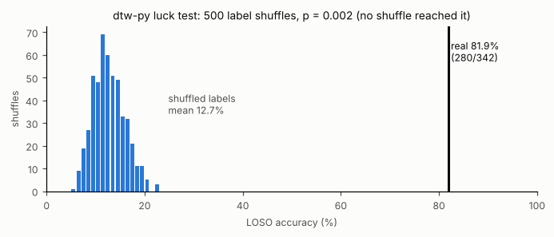

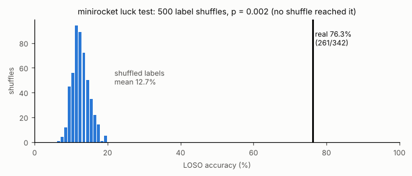

The luck test shows the models are far above chance. It does not measure tuning optimism: the tuned 94.2% and the untuned 81.9% DTW both get
p = 0.002. For that, see the nested 88.2% above.

Not run for minirocket (L96-clip), cnn, cnn (L96-clip) (each shuffle means retraining every fold; the cheap exact shortcut exists only for
dtw-py and minirocket).

#### Leave one clip out

Train on every other clip, including takes from the same sitting, so it is optimistic. Shown for completeness.

| Model | Accuracy | Macro F1 | None false accept | Infer ms/clip |
|---|---:|---:|---:|---:|
| dtw-knn (JS) | 96.2% (329/342) | 0.962 | 0.0% (0/27) | 15.6 |
| dtw-py | 96.2% (329/342) | 0.962 | 0.0% (0/27) | ~300.4 |
| minirocket | 89.8% (307/342) | 0.901 | 0.0% (0/27) | ~6.8 |
| cnn | 90.4% (309/342) | 0.907 | 3.7% (1/27) | ~3.7 |

#### JS vs Python DTW cross check

Same data and the same settings (L, band, k, norm, channels, hpHz, threshold, and budNorm when there are right bud
clips) are checked first.

| Protocol | Data | Accuracy JS | Accuracy Python | Gap (points) | None FA JS | None FA Python | Within 5? |
|---|---|---:|---:|---:|---:|---:|---|
| LOSO | `ss-dataset-s1-20261031-1621.json`, `ss-dataset-s2-20261031-1637.json`, `ss-dataset-s3-20261031-1654.json` | 94.2% (322/342) | 94.2% (322/342) | 0.0 | 0.0% | 0.0% | yes, same confusion matrix |
| LOO | `ss-dataset-s1-20261031-1621.json`, `ss-dataset-s2-20261031-1637.json`, `ss-dataset-s3-20261031-1654.json` | 96.2% (329/342) | 96.2% (329/342) | 0.0 | 0.0% | 0.0% | yes, same confusion matrix |

#### Confusion matrices

Rows = true label, columns = predicted.

##### dtw-knn (JS)

**LOSO**

| true \ pred | calendar | call_back | demo_48h | focus_music | help | none | text_mom | volume_up |
|---|---|---|---|---|---|---|---|---|
| **calendar** | 40 | 1 | . | . | 1 | . | 3 | . |
| **call_back** | . | 44 | . | . | . | 1 | . | . |
| **demo_48h** | . | . | 43 | . | . | 1 | . | 1 |
| **focus_music** | 1 | 2 | . | 40 | 1 | 1 | . | . |
| **help** | . | 1 | . | 1 | 43 | . | . | . |
| **none** | 1 | 1 | . | . | . | 25 | . | . |
| **text_mom** | . | . | . | . | . | 1 | 44 | . |
| **volume_up** | . | . | . | . | . | 1 | 1 | 43 |

**LOO**

| true \ pred | calendar | call_back | demo_48h | focus_music | help | none | text_mom | volume_up |
|---|---|---|---|---|---|---|---|---|
| **calendar** | 44 | . | . | . | . | . | 1 | . |
| **call_back** | . | 44 | . | . | . | . | 1 | . |
| **demo_48h** | . | . | 43 | . | . | . | . | 2 |
| **focus_music** | . | 1 | . | 43 | 1 | . | . | . |
| **help** | 1 | 2 | . | . | 42 | . | . | . |
| **none** | . | 1 | 1 | . | . | 25 | . | . |
| **text_mom** | . | . | . | . | . | . | 45 | . |
| **volume_up** | 1 | . | . | . | . | . | 1 | 43 |

##### dtw-py

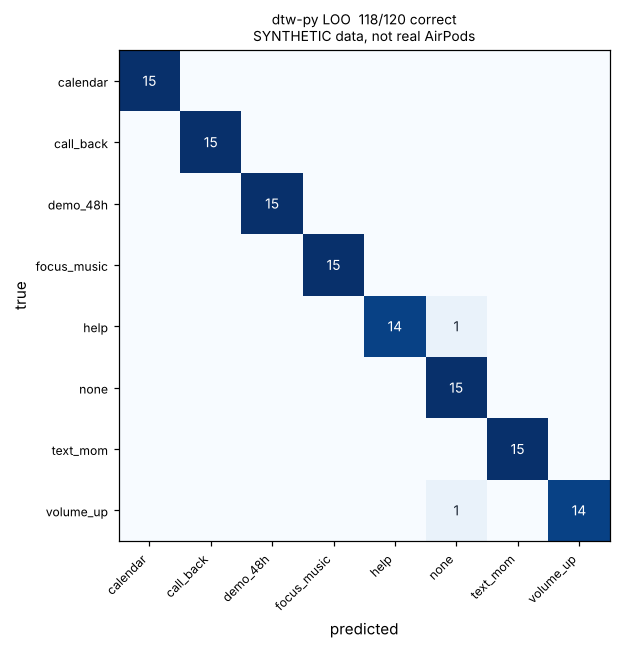

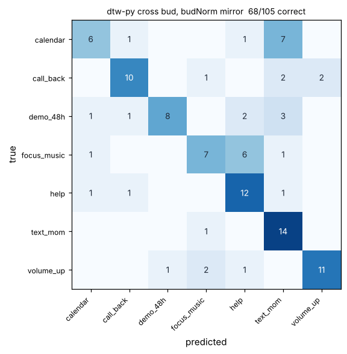

##### dtw-py (phase1-settings)

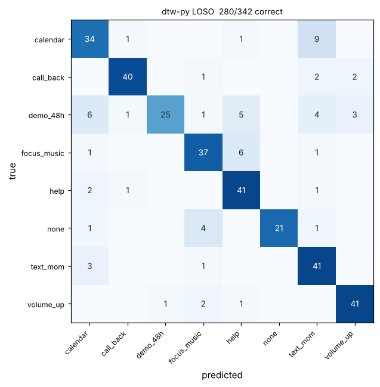

##### minirocket

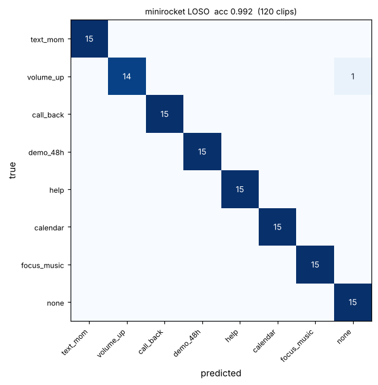

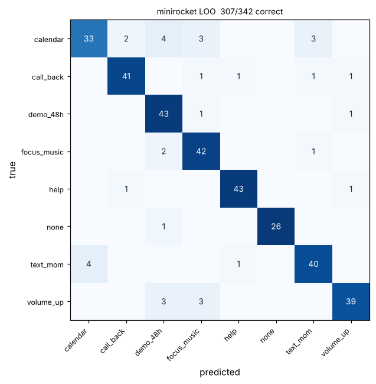

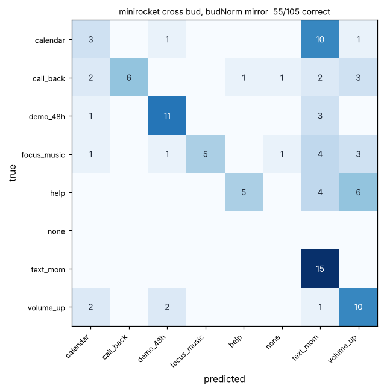

##### minirocket (L96-clip)

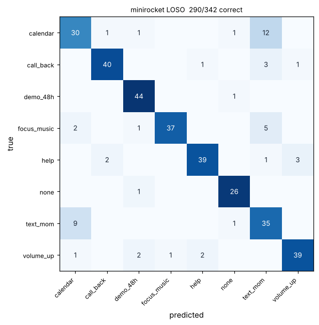

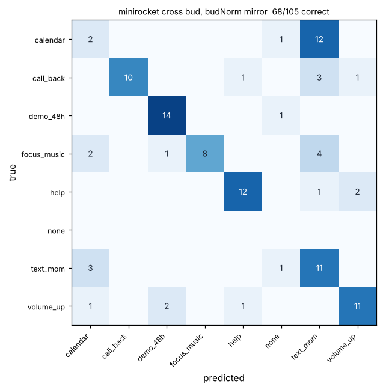

##### cnn

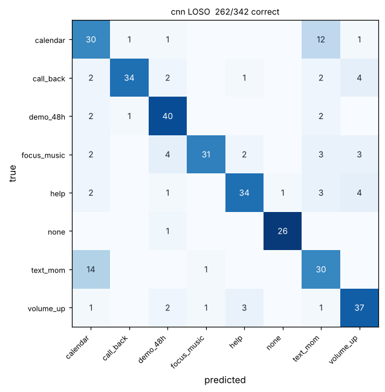

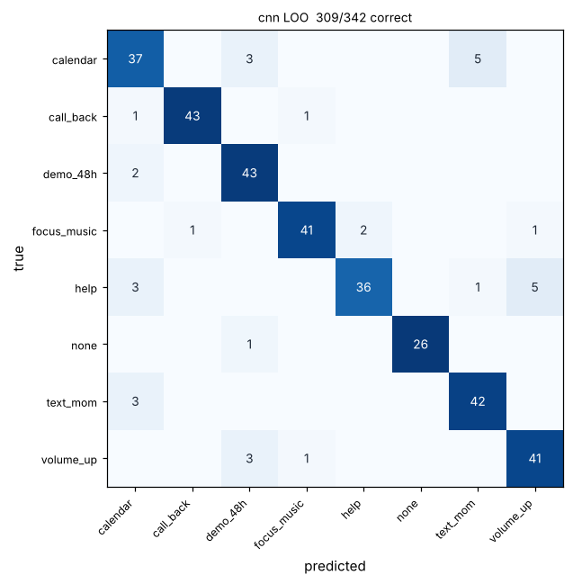

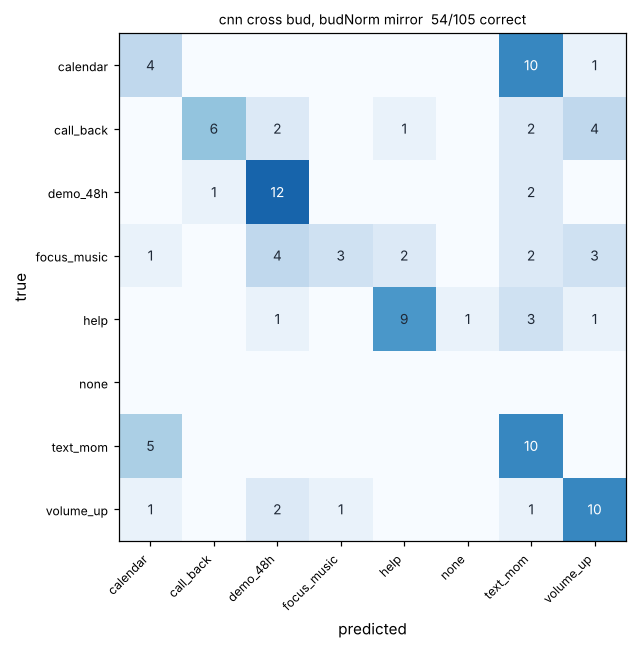

##### cnn (L96-clip)

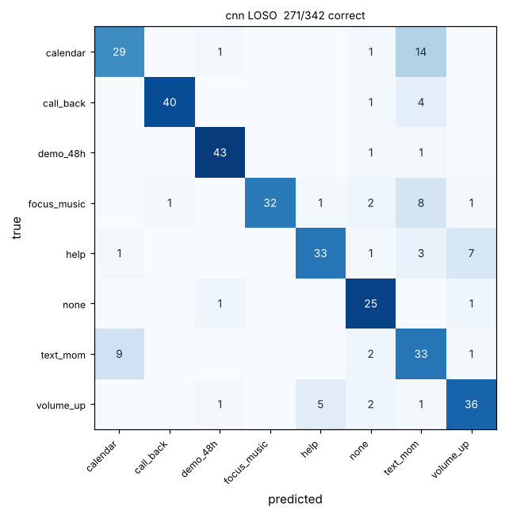

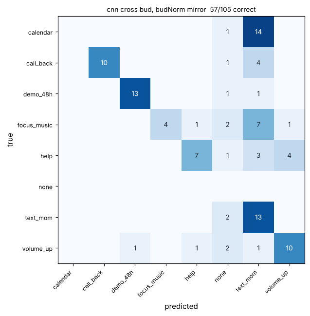

## Synthetic fixture (not real AirPods data)

> **Synthetic fixture, not real AirPods data.** Generated fake motion from `shared/fixtures/`.
> It shows the code works end to end. It says nothing about real mouthed sentences.

| Model | Protocol | Accuracy | Macro F1 | None false accept | Infer ms/clip | Data |
|---|---|---:|---:|---:|---:|---|
| dtw-knn | LOSO | 100.0% (120/120) | 1.000 | 0.0% | 2.9 | `dataset.synthetic.json` (*synthetic*) |
| dtw-knn | LOO | 100.0% (120/120) | 1.000 | 0.0% | 3.6 | `dataset.synthetic.json` (*synthetic*) |
| dtw-py | LOSO | 100.0% (120/120) | 1.000 | 0.0% | ~48.4 | `dataset.synthetic.json` (*synthetic*) |
| dtw-py | LOO | 100.0% (120/120) | 1.000 | 0.0% | ~83.7 | `dataset.synthetic.json` (*synthetic*) |
| minirocket | LOSO | 99.2% (119/120) | 0.992 | 0.0% | ~3.8 | `dataset.synthetic.json` (*synthetic*) |
| minirocket | LOO | 98.3% (118/120) | 0.983 | 0.0% | ~7.0 | `dataset.synthetic.json` (*synthetic*) |
| cnn | LOSO | 97.5% (117/120) | 0.975 | 0.0% | 2.1 | `dataset.synthetic.json` (*synthetic*) |
| cnn | LOO | 98.3% (118/120) | 0.984 | 0.0% | 1.0 | `dataset.synthetic.json` (*synthetic*) |

- Highest LOSO on `dataset.synthetic.json`: **dtw-knn (JS)** and **dtw-py** (tie), 120/120 correct (100.0%).
- Highest LOO on `dataset.synthetic.json`: **dtw-knn (JS)** and **dtw-py** (tie), 120/120 correct (100.0%).

### JS vs Python DTW cross check (synthetic)

Same data and the same settings (L, band, k, norm, channels, hpHz, threshold, and budNorm when there are right bud
clips) are checked first.

| Protocol | Data | Accuracy JS | Accuracy Python | Gap (points) | None FA JS | None FA Python | Within 5? |
|---|---|---:|---:|---:|---:|---:|---|
| LOSO | `dataset.synthetic.json` | 100.0% (120/120) | 100.0% (120/120) | 0.0 | 0.0% | 0.0% | yes, same confusion matrix |
| LOO | `dataset.synthetic.json` | 100.0% (120/120) | 100.0% (120/120) | 0.0 | 0.0% | 0.0% | yes, same confusion matrix |

### Confusion matrices (synthetic)

Rows = true label, columns = predicted.

#### dtw-knn (JS)

**LOSO**

| true \ pred | calendar | call_back | demo_48h | focus_music | help | none | text_mom | volume_up |
|---|---|---|---|---|---|---|---|---|
| **calendar** | 15 | . | . | . | . | . | . | . |
| **call_back** | . | 15 | . | . | . | . | . | . |
| **demo_48h** | . | . | 15 | . | . | . | . | . |
| **focus_music** | . | . | . | 15 | . | . | . | . |
| **help** | . | . | . | . | 15 | . | . | . |
| **none** | . | . | . | . | . | 15 | . | . |
| **text_mom** | . | . | . | . | . | . | 15 | . |
| **volume_up** | . | . | . | . | . | . | . | 15 |

**LOO**

| true \ pred | calendar | call_back | demo_48h | focus_music | help | none | text_mom | volume_up |
|---|---|---|---|---|---|---|---|---|
| **calendar** | 15 | . | . | . | . | . | . | . |
| **call_back** | . | 15 | . | . | . | . | . | . |
| **demo_48h** | . | . | 15 | . | . | . | . | . |
| **focus_music** | . | . | . | 15 | . | . | . | . |
| **help** | . | . | . | . | 15 | . | . | . |
| **none** | . | . | . | . | . | 15 | . | . |
| **text_mom** | . | . | . | . | . | . | 15 | . |
| **volume_up** | . | . | . | . | . | . | . | 15 |

#### dtw-py

#### minirocket

#### cnn

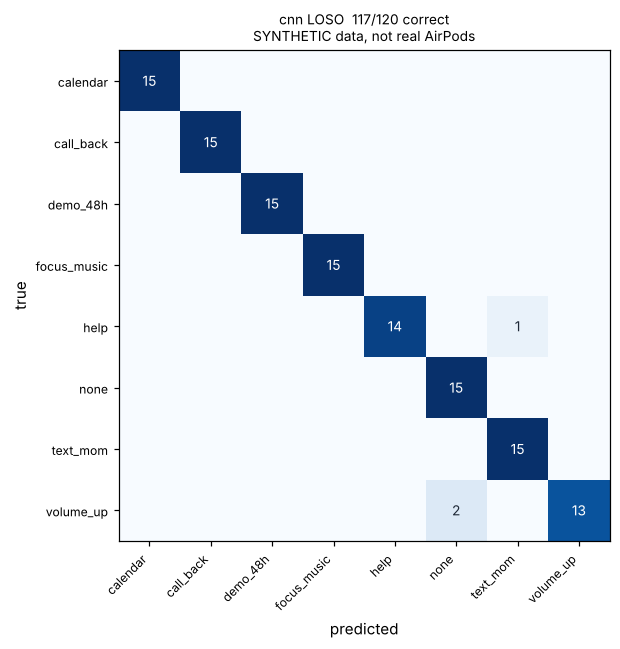

