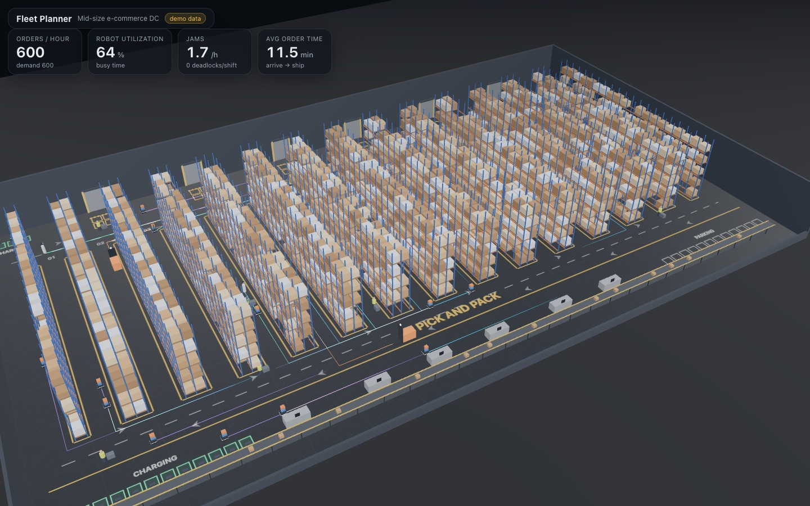

# Fleet Planner

> A 3D warehouse simulator in your browser that tells a warehouse owner which robots to buy, how many, and when they pay for themselves.

**Live demo:** https://spiro-12.github.io/weekend-projects/02-fleet-planner/

_Work in progress (Phase 0 skeleton with demo data). The full write up, demo GIF and the "many brains vs one brain" clip land in Phase 3._

- [RESEARCH.md](RESEARCH.md): robot specs and prices with sources, the SimReady asset survey, the tech choices, the market and why now
- [PLAN.md](PLAN.md): the phased build plan
- PROTOCOL.md (Phase 0): the contracts between the sim, the renderer and the UI

## What it does

## Why it's cool

## How it works

## Built with
3D models from NVIDIA SimReady (CC BY 4.0), via the browser-ready conversion at huggingface.co/datasets/codepawl/simready-glb. Full credits in CREDITS.md.
