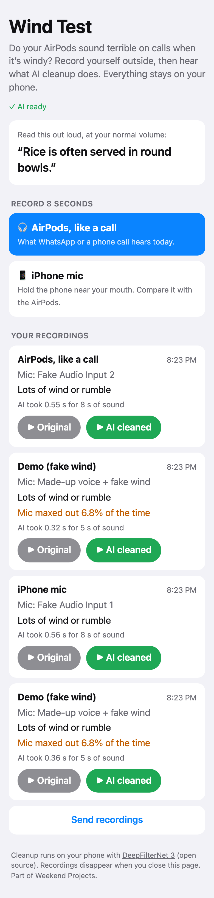

# Wind Test

> Your AirPods sound awful on calls when it's windy. Record yourself outside and hear what AI cleanup does.

**Live demo:** https://spiro-12.github.io/weekend-projects/04-wind-test/ (open it in Safari on an iPhone, with AirPods in)

## What it does
You read a short sentence outside, and the page records 8 seconds:
- through your **AirPods**, the same way a call hears them, or
- through the **iPhone's own mic**.

An open-source AI model (DeepFilterNet 3) then cleans each recording **on your phone**. You play "Original" and "AI cleaned" back to back. The page also tells you:
- how much wind it heard
- whether the mic maxed out
- how fast the AI ran

"Send recordings" shares the audio files and a summary of the numbers.

## Why
People on calls keep telling me I sound like I'm in a wind tunnel. It's not just me: the complaint shows up on Reddit and Apple's forums every year, even with the newest AirPods Pro. iPhones don't let any app touch the audio of a normal call, so a fix would have to be its own calling app. Before building one, this page answers the cheap question first: does AI cleanup make a real difference to a windy AirPods voice? It's free, and there's nothing to install.

## How it works
- **Recording:** an AudioWorklet records the raw microphone samples at 48 kHz. The echo cancellation, noise suppression and auto gain options are on, which on iPhone switches on the same voice processing a call uses.
- **Cleaning:** a Web Worker runs DeepFilterNet 3, compiled to WebAssembly (`df/`, built by `scripts/build-deepfilter-wasm.sh`), with the ONNX model in `model/`. It feeds the model 10 ms frames, like a live call would, and removes the model's 30 ms delay so the two versions line up.
- **Measuring:** the share of sound below 150 Hz (wind is mostly there, speech isn't), the share of samples at full scale, and the overall level.
- **Test:** `node 04-wind-test/test/e2e.mjs` (the `wind` CI job) runs the whole page in headless Chromium with a fake microphone playing a made-up voice in wind: it records, cleans, checks the wind is cut, the cleaned copy lines up, and every take is cleaned the same way.
- **Fair comparison, works offline:** one Web Worker downloads the AI once when the page opens. The model remembers recent audio, so every recording gets a brand-new model state (the build script adds a `df_free` export so old states can be dropped). Each take is cleaned exactly the same way, and recordings outdoors don't need signal (unless the AI crashes and has to download again).

A native iPhone version (more mic modes, Voice Isolation) is being built alongside this.

## Built with
Plain HTML and JavaScript, Web Audio, Web Workers, [DeepFilterNet](https://github.com/Rikorose/DeepFilterNet) (MIT/Apache-2.0) via Rust → WebAssembly.
